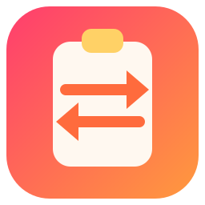

<div align="center">
  
  <h1>ClipboardSync</h1>
  <p><strong>一度コピーすれば、持っているすべての端末に貼り付け。</strong></p>
  <p>
    <a href="https://t2penbix99wcoxkv3a4g.github.io/ClipboardSync/">ウェブサイト</a> ·
    <a href="https://t2penbix99wcoxkv3a4g.github.io/ClipboardSync/#/docs/Getting-Started">ドキュメント</a>
  </p>
  <p>
    <a href="README.md">English</a> ·
    <a href="README.zh-CN.md">简体中文</a> ·
    <a href="README.zh-TW.md">繁體中文</a>
  </p>
</div>

ClipboardSync は、ペアリングした端末の間で 1 つのクリップボードボードを共有します。ある端末で
テキスト、リンク、画像、ファイル、フォルダーをコピーすると、ほかの端末に表示され、そのまま貼り
付けられます。すべての端末は暗号化されたセッションで直接通信し、アカウントも中央のサーバーも
ありません。

## なぜ必要か

デスクトップとノート PC の間でリンクやスクリーンショットを移動するために、自分宛てに送ったり、
チャットアプリを開いたり、クラウドのクリップボードを信頼したりする必要はないはずです。
ClipboardSync は自分の端末を一度ペアリングすれば、あとは自分のネットワーク内で同じボードに保ち、
クリップボードの中身は端末間で暗号化されます。

## 機能

- **1 つの共有ボード** — ペアリングしたすべての端末が同じ履歴を表示し、項目はコピー元の端末ごとに
  まとまります（自分の端末も含みます）。新しいコピーはすべてのピアに送られ、ピアは保存し、自分の
  クリップボードに反映し、まだ必要とするピアへ転送します。
- **テキストとリンク** — テキストや URL をコピーすると、ほかの端末に送られ、そのクリップボードに
  反映されます。
- **画像** — コピーした画像は PNG として送られ、ボードにプレビュー表示され、自動的に反映されます。
  サイズ上限は 1〜32 MB（既定 10 MB）で変更できます。
- **ファイルとフォルダー** — コピーした選択を再帰的に走査し、各ファイルを SHA-256 の内容定址 blob
  として保存します。ピアは不足している範囲だけを取得するため、再接続時は止まった位置から再開でき、
  同じ内容のファイルは 1 つの blob を共有します。受信した項目はハードリンク（不可ならコピー）で
  実体化され、通常のファイルやフォルダーとしてクリップボードに戻ります。
- **直接接続** — 端末はローカルネットワークで UDP を使って互いを見つけ、TCP で通信します。第三者を
  経由せず、ブロードキャストが使えないネットワークでは手動アドレスを指定できます。
- **暗号化されたセッション** — 各端末は長期的な Ed25519 識別鍵を持ちます。接続ごとに新しい X25519
  一時鍵を使い、HKDF-SHA256 でセッション鍵を導出し、すべてのフレームを ChaCha20-Poly1305 で、
  ハンドシェイクのやり取りを関連データとして暗号化します。
- **ペアリングコード** — 両方の画面がハンドシェイクから同じ短いコードを導出するので、端末を信頼する
  前に見比べられます。コードはパスワードとして送られることはありません。
- **項目ごとの転送状態** — 同期済み、送信中、受信中、待機中、失敗のいずれかと、その項目を持つ
  ピアの数。
- **ボードの自動補完** — 定期的な照合が、確認されていない項目を送り直します。もう一度ペアリング
  すると現在のボードをまとめて送り、オフラインだった端末は戻ったときに不足分を埋めます。

## 使用技術

- **.NET 10 上の C#** — クリップボードの監視と書き込み、ピア検出、TCP セッション、ペアリング、
  暗号化、履歴、トレイ、設定。
- **React 19 + TypeScript**、 **Vite** でバンドルし **styled-components** でスタイル —
  インターフェース。C# 側と JSON メッセージを交換するだけで、自身では処理を行いません。
- **Photino.NET** — デスクトップシェル。OS 自身の Web ビューでインターフェースを表示するため、
  Web ビューが実行時の依存になります: Windows は WebView2、Linux は WebKitGTK。
- **BouncyCastle** — Ed25519、X25519、ChaCha20-Poly1305。

## 実行

公開ビルドは **自己完結型** で、.NET ランタイムを同梱しているため、ほかに何もインストールする
必要はありません。OS が用意する必要があるものは以下です。

4 種類のパッケージを公開しています:

| ファイル                                       | 内容                                                                                                                                                                                    |
|------------------------------------------------|-----------------------------------------------------------------------------------------------------------------------------------------------------------------------------------------|
| `ClipboardSync-<version>-win-x64.msi`          | ユーザーごとの Windows インストーラー。`%LOCALAPPDATA%\Programs\ClipboardSync` にインストールし、スタートメニューとデスクトップにショートカットを作成します。管理者権限は要求しません。 |
| `clipboardsync-<version>-1.fcXX.x86_64.rpm`    | Fedora パッケージ: `sudo dnf install ./clipboardsync-<version>-*.rpm`。`/opt/ClipboardSync` にインストールし、`clipboardsync` コマンド、デスクトップエントリ、アイコンを追加します。    |
| `clipboardsync_<version>_amd64.deb`            | Debian/Ubuntu パッケージ: `sudo apt install ./clipboardsync_<version>_amd64.deb`。構成は RPM と同じです。                                                                               |
| `clipboardsync-<version>-1-x86_64.pkg.tar.zst` | Arch Linux パッケージ: `sudo pacman -U clipboardsync-<version>-1-x86_64.pkg.tar.zst`。構成は RPM と同じです。                                                                           |

### Windows

1. Microsoft Edge **WebView2 ランタイム**。Windows 10 と 11 には通常入っています。ない場合は
   [Microsoft のページ](https://developer.microsoft.com/microsoft-edge/webview2/) を参照して
   ください。
2. Windows 10 以降、x64。
3. ビルドはコード署名されていないため、初回起動時に警告が出ることがあります。

### Linux

1. GTK 用の Web ビュー。
2. AppIndicator ライブラリ。トレイアイコン専用です。なくてもアプリは動作しますが、トレイがなく、
   メインウィンドウが表示されたままになります。
3. 自己完結型ビルドが必要とする .NET ランタイムライブラリ（ICU、OpenSSL、zlib、krb5、fontconfig、
   freetype）はパッケージで導入されます。単体アーカイブでは手動で入れる必要があります。

| ディストリビューション | パッケージ                                                                   |
|------------------------|------------------------------------------------------------------------------|
| Fedora                 | `sudo dnf install webkit2gtk4.1 libayatana-appindicator-gtk3 libnotify`      |
| Debian / Ubuntu        | `sudo apt install libwebkit2gtk-4.1-0 libayatana-appindicator3-1 libnotify4` |
| Arch Linux             | `sudo pacman -S webkit2gtk-4.1 libayatana-appindicator`                      |
| そのほか               | 下記のライブラリを提供するパッケージを探してください                         |

```
libwebkit2gtk-4.1.so.0          libjavascriptcoregtk-4.1.so.0
libgtk-3.so.0                   libglib-2.0.so.0
libayatana-appindicator3.so.1   (または古い libappindicator3.so.1)
```

Web ビューのライブラリがない場合は、起動時に `Unable to load shared library 'Photino.Native'` と
表示されます。不足している soname を提供するパッケージは、パッケージマネージャーに問い合わせて
ください。たとえば `dnf provides 'libwebkit2gtk-4.1.so.0'`、
`apt-file search libwebkit2gtk-4.1.so.0`、`pacman -F libwebkit2gtk-4.1.so.0` です。

## 初回起動

1. **2 台の端末を起動** し、同じネットワークで互いに到達できるようにします。TCP 45456 が
   ペアリングとクリップボードの通信に使われ、UDP 45457 は検出のヒントだけに使われます。
2. **ペアリング** は **デバイス → 端末をペアリング** から行います。検出された端末を選ぶか
   アドレスを入力し、両方の画面に出るコードを見比べます。ペアリングは各端末の公開鍵を記録し、
   双方が鍵を持っていることを証明します。
3. **何かコピー** します。項目は両方のボードに現れ、相手のクリップボードに反映されます。

詳しい手順は [ドキュメント](https://t2penbix99wcoxkv3a4g.github.io/ClipboardSync/#/docs/Getting-Started)
にあります。

## ビルド

- [.NET 10 SDK](https://dotnet.microsoft.com/download)
- インターフェースをビルドするための [Node.js](https://nodejs.org/) 20 以降
- `ClipboardSync/Libs` にある共有 DLL とフロントエンドブリッジのパッケージ。別プロジェクトの
  [PhotinoNETUtils](../PhotinoNETUtils) から `build-and-copy.ps1` でコピーします。

## ビルドと実行

### 開発

インターフェースは Vite が配信するため、両方を起動します。

```bash
# ターミナル 1 — インターフェース (http://127.0.0.1:3300)
cd ClipboardSync/UserInterface
npm install
npm run dev

# ターミナル 2 — デスクトップアプリ
dotnet run --project ClipboardSync
```

デバッグビルドは開発サーバーからインターフェースを読み込みます。
`dotnet run --project ClipboardSync -- --identity` は、ペアリングで使う安定した ID、公開鍵、
フィンガープリントを表示します。

### リリース

`npm run build` はインターフェースを `ClipboardSync/Resources/wwwroot` にコピーし、プロジェクトが
それを実行ファイルに埋め込みます。そのため、公開する前にインターフェースをビルドしてください。

```bash
cd ClipboardSync/UserInterface && npm run build
cd ../.. && dotnet publish ClipboardSync/ClipboardSync.csproj -c Release -r win-x64
```

Linux では `-r linux-x64` を使います。`ClipboardSync/bin/Release/net10.0/<rid>/publish/` に
自己完結型の単一実行ファイルができます。

### パッケージ

インストーラースクリプトは公開済みのビルドを入力にし、`release/` に出力します:

```bash
# Windows — WiX は初回にローカルへインストールされます
./installer/windows/build-msi.ps1 -Version 0.1.0 -SourceDir publish/win-x64 -OutputDir release

# Linux — 各ディストリビューション上、またはスクリプト冒頭のコンテナ内で実行します
VERSION=0.1.0 PUBLISH_DIR=publish/linux-x64 OUTPUT_DIR=release bash installer/linux/build-deb.sh
VERSION=0.1.0 PUBLISH_DIR=publish/linux-x64 OUTPUT_DIR=release bash installer/linux/build-rpm.sh
VERSION=0.1.0 PUBLISH_DIR=publish/linux-x64 OUTPUT_DIR=release bash installer/linux/build-arch.sh
```

リリースワークフローは公開後にこの 4 つを実行します。

## 保存場所

|                    | Windows                                            | Linux                                              |
|--------------------|----------------------------------------------------|----------------------------------------------------|
| 設定               | `%APPDATA%\ClipboardSync\settings.json`            | `~/.config/ClipboardSync/settings.json`            |
| ペアリング済み端末 | `%APPDATA%\ClipboardSync\peers.json`               | `~/.config/ClipboardSync/peers.json`               |
| 端末の識別情報     | `%APPDATA%\ClipboardSync\device.key`               | `~/.config/ClipboardSync/device.key`               |
| 履歴               | `%LOCALAPPDATA%\ClipboardSync\history.json`        | `~/.local/share/ClipboardSync/history.json`        |
| 画像キャッシュ     | `%LOCALAPPDATA%\ClipboardSync\clipboard`           | `~/.local/share/ClipboardSync/clipboard`           |
| ファイル blob      | `%LOCALAPPDATA%\ClipboardSync\clipboard\blobs`     | `~/.local/share/ClipboardSync/clipboard/blobs`     |
| ファイル表示       | `%LOCALAPPDATA%\ClipboardSync\clipboard\items`     | `~/.local/share/ClipboardSync/clipboard/items`     |
| ログ               | `%APPDATA%\ClipboardSync\logs\clipboardsync-*.log` | `~/.config/ClipboardSync/logs/clipboardsync-*.log` |

識別鍵はペアリング時に相手が記録するものです。設定フォルダは自分のアカウントだけが読めるように
してください。履歴は **設定 → 履歴 → 保持する項目数** で上限が決まります。

ログはファイルに書き込まれ、コンソールにも複製されます。問題を報告するときはログファイルだけで
十分です。ログは毎日ローテーションし、直近 7 日分を保持します。

## 注意

- ファイルとフォルダーは再帰的にコピーされます。1 回の選択は **設定 → 同期 → ファイルサイズ上限**
  （既定 512 MB）と 1,000 エントリーで制限されます。blob は内容定址で項目間で共有され、実体化した
  表示はファイルシステムが許せばハードリンクを使います。転送は暗号化されますが、ディスク上の blob
  ストアはローカルデータフォルダーにある通常の平文ファイルです。
- **設定 → 同期 → Blob 保存フォルダー** で blob の保存先を変更できます。空欄ならアプリのデータ
  フォルダーを使い、変更すると既存の blob は移動します。
- メッシュは、各端末が TCP 45456 でほかの端末に到達できることが前提です。UDP 45457 は検出の
  ヒントにすぎません。ブロードキャストが使えないネットワークでは手動アドレス欄を使ってください。
- ウィンドウを閉じるとアプリはトレイに移動します。トレイに入った状態で起動したい場合は **ウィンドウを隠して起動**
  をオンにしてください。トレイがない環境では常にウィンドウが表示されます。
- Linux はコンポジターのネイティブタイトルバーを使います。Windows はフレームを残し、その内側に
  インターフェースのタイトルバーを描きます。これにより、装飾なしウィンドウを強制したときに KWin が
  残す二重のタイトルバーを避けられます。
- `PhotinoNETUtils` は `Libs/` の DLL/NPM tarball として参照しています。ライブラリを更新したら
  `build-and-copy` スクリプトを再実行してください。`ClipboardSync` はすでにターゲットに含まれて
  います。

## ライセンス

MIT — [LICENSE](LICENSE) を参照してください。
