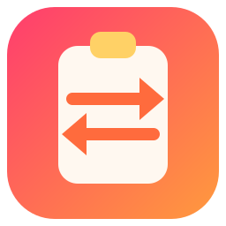

<div align="center">
  
  <h1>ClipboardSync</h1>
  <p><strong>Copy once, paste on every device you own.</strong></p>
  <p>
    <a href="https://t2penbix99wcoxkv3a4g.github.io/ClipboardSync/">Website</a> ·
    <a href="https://t2penbix99wcoxkv3a4g.github.io/ClipboardSync/#/docs/Getting-Started">Documentation</a>
  </p>
  <p>
    <a href="README.ja.md">日本語</a> ·
    <a href="README.zh-CN.md">简体中文</a> ·
    <a href="README.zh-TW.md">繁體中文</a>
  </p>
</div>

ClipboardSync keeps one clipboard board across the devices you pair. Copy text, a link, an image, a file
or a folder on one machine and it shows up on the others, ready to paste. Every device talks directly
to the others over an encrypted session; there is no account and no server in the middle.

## Why

Moving a link or a screenshot between a desktop and a laptop should not mean sending it to yourself,
opening a chat app, or trusting a cloud clipboard. ClipboardSync pairs your own devices once and then
keeps them on the same board, on your own network, with the clipboard contents encrypted end to end.

## Features

- **One shared board** — every paired device shows the same history, grouped by the device an item
  came from, including its own. A new copy goes to all peers; they store it, apply it to their
  clipboard, and relay it further when another peer is still missing it.
- **Text and links** — copying text or a URL sends it to the other devices and applies it to their
  clipboard.
- **Images** — image copies are sent as PNG, previewed on the board and applied automatically. The
  size limit is configurable from 1 to 32 MB (10 MB by default).
- **Files and folders** — a copied selection is walked recursively and each file becomes a
  content-addressed SHA-256 blob. Peers pull only the ranges they are missing, so a reconnect resumes
  where it stopped, and identical files share one blob. Received items are materialised with
  hardlinks (or copies) and put back on the clipboard as ordinary files and folders.
- **Direct connections** — devices find each other on the local network over UDP and talk over TCP.
  Nothing is relayed through a third party, and a manual address covers networks where broadcast is
  blocked.
- **Encrypted sessions** — each device has a long-term Ed25519 identity. Connections use fresh X25519
  ephemeral keys, HKDF-SHA256 derives a per-session key, and every frame is ChaCha20-Poly1305 with
  the handshake transcript as associated data.
- **Pairing code** — both screens derive the same short code from the handshake, so you can compare
  them before trusting a device. The code is never sent as a password.
- **Transfer state per item** — synced, sending, receiving, waiting or failed, with a count of how
  many peers hold the item.
- **Convergence** — a periodic reconciliation resends anything a peer has not acknowledged, and
  pairing again sends the current board as a catch-up. A device that was offline fills in the gaps
  when it returns.

## Built with

- **C# on .NET 10** — the clipboard watcher and writer, peer discovery, TCP sessions, pairing,
  encryption, history, the tray and the settings.
- **React 19 + TypeScript**, bundled by **Vite** and styled with **styled-components** — the
  interface. It exchanges JSON messages with the C# side and does no work of its own.
- **Photino.NET** — the desktop shell. It shows the interface in the operating system's own web
  view, which is why the web view is a runtime dependency: WebView2 on Windows, WebKitGTK on Linux.
- **BouncyCastle** — Ed25519, X25519 and ChaCha20-Poly1305.

## Running

The published builds are **self-contained** — they bundle the .NET runtime, so nothing needs to be
installed for them. What the operating system still has to provide is listed below.

Four package formats are published beside the plain archives:

| File                                           | What it does                                                                                                                                                       |
|------------------------------------------------|--------------------------------------------------------------------------------------------------------------------------------------------------------------------|
| `ClipboardSync-<version>-win-x64.msi`          | Per-user Windows installer: installs into `%LOCALAPPDATA%\Programs\ClipboardSync`, adds Start menu and desktop shortcuts, and never asks for administrator rights. |
| `clipboardsync-<version>-1.fcXX.x86_64.rpm`    | Fedora package: `sudo dnf install ./clipboardsync-<version>-*.rpm`. Installs to `/opt/ClipboardSync` with a `clipboardsync` command, a desktop entry and the icon. |
| `clipboardsync_<version>_amd64.deb`            | Debian/Ubuntu package: `sudo apt install ./clipboardsync_<version>_amd64.deb`. Same layout as the RPM.                                                             |
| `clipboardsync-<version>-1-x86_64.pkg.tar.zst` | Arch Linux package: `sudo pacman -U clipboardsync-<version>-1-x86_64.pkg.tar.zst`. Same layout as the RPM.                                                         |

### Windows

1. The Microsoft Edge **WebView2 Runtime**. Windows 10 and 11 normally already have it; otherwise
   use [Microsoft's page](https://developer.microsoft.com/microsoft-edge/webview2/).
2. Windows 10 or newer, x64.
3. The build is not code-signed, so Windows may warn the first time it is started.

### Linux

1. The web view for GTK.
2. An AppIndicator library, for the tray icon only. Without it the app still runs; it just has no
   tray and keeps its main window visible instead.
3. The .NET runtime libraries the self-contained build needs (ICU, OpenSSL, zlib, krb5, fontconfig,
   freetype) are pulled in by the packages. A plain archive needs them installed by hand.

| Distribution    | Packages                                                                     |
|-----------------|------------------------------------------------------------------------------|
| Fedora          | `sudo dnf install webkit2gtk4.1 libayatana-appindicator-gtk3 libnotify`      |
| Debian / Ubuntu | `sudo apt install libwebkit2gtk-4.1-0 libayatana-appindicator3-1 libnotify4` |
| Arch Linux      | `sudo pacman -S webkit2gtk-4.1 libayatana-appindicator`                      |
| anything else   | find whatever provides the libraries below                                   |

```
libwebkit2gtk-4.1.so.0          libjavascriptcoregtk-4.1.so.0
libgtk-3.so.0                   libglib-2.0.so.0
libayatana-appindicator3.so.1   (or the older libappindicator3.so.1)
```

A missing web view library shows up as `Unable to load shared library 'Photino.Native'` at startup.
To find the package that owns a missing soname, ask your package manager — for example
`dnf provides 'libwebkit2gtk-4.1.so.0'`, `apt-file search libwebkit2gtk-4.1.so.0`, or
`pacman -F libwebkit2gtk-4.1.so.0`.

## First run

1. **Start two devices** that can reach each other on the same network. TCP 45456 carries pairing and
   clipboard traffic; UDP 45457 is only the discovery hint.
2. **Pair them** under **Devices → Pair a device**. Pick a discovered device or enter its address,
   then compare the code shown on both screens. The pairing pins each device's public key and proves
   both sides own it.
3. **Copy something.** The item appears on both boards and is applied to the other clipboard.

The full guide is in the [documentation](https://t2penbix99wcoxkv3a4g.github.io/ClipboardSync/#/docs/Getting-Started).

## Building

- [.NET 10 SDK](https://dotnet.microsoft.com/download)
- [Node.js](https://nodejs.org/) 20 or newer, to build the interface
- The shared DLL and front-end bridge package in `ClipboardSync/Libs`, copied from the separate
  [PhotinoNETUtils](../PhotinoNETUtils) project with its `build-and-copy.ps1`

## Build and run

### Development

The interface is served by Vite, so run both:

```bash
# terminal 1 — the interface on http://127.0.0.1:3300
cd ClipboardSync/UserInterface
npm install
npm run dev

# terminal 2 — the desktop app
dotnet run --project ClipboardSync
```

Debug builds load the interface from the dev server. `dotnet run --project ClipboardSync --
--identity` prints the stable id, public key and fingerprint used by pairing.

### Release

`npm run build` copies the interface into `ClipboardSync/Resources/wwwroot`, which the project embeds
into the executable — so build the interface before publishing.

```bash
cd ClipboardSync/UserInterface && npm run build
cd ../.. && dotnet publish ClipboardSync/ClipboardSync.csproj -c Release -r win-x64
```

Use `-r linux-x64` for Linux. That produces a single self-contained executable under
`ClipboardSync/bin/Release/net10.0/<rid>/publish/`.

### Packages

The installer scripts take a published build and write to `release/`:

```bash
# Windows — WiX is installed locally on first use
./installer/windows/build-msi.ps1 -Version 0.1.0 -SourceDir publish/win-x64 -OutputDir release

# Linux — run each script on its own distribution, or in the container shown in the script header
VERSION=0.1.0 PUBLISH_DIR=publish/linux-x64 OUTPUT_DIR=release bash installer/linux/build-deb.sh
VERSION=0.1.0 PUBLISH_DIR=publish/linux-x64 OUTPUT_DIR=release bash installer/linux/build-rpm.sh
VERSION=0.1.0 PUBLISH_DIR=publish/linux-x64 OUTPUT_DIR=release bash installer/linux/build-arch.sh
```

The release workflow runs all four after the publish step.

## Where things are stored

|                 | Windows                                            | Linux                                              |
|-----------------|----------------------------------------------------|----------------------------------------------------|
| Settings        | `%APPDATA%\ClipboardSync\settings.json`            | `~/.config/ClipboardSync/settings.json`            |
| Paired devices  | `%APPDATA%\ClipboardSync\peers.json`               | `~/.config/ClipboardSync/peers.json`               |
| Device identity | `%APPDATA%\ClipboardSync\device.key`               | `~/.config/ClipboardSync/device.key`               |
| History         | `%LOCALAPPDATA%\ClipboardSync\history.json`        | `~/.local/share/ClipboardSync/history.json`        |
| Image cache     | `%LOCALAPPDATA%\ClipboardSync\clipboard`           | `~/.local/share/ClipboardSync/clipboard`           |
| File blobs      | `%LOCALAPPDATA%\ClipboardSync\clipboard\blobs`     | `~/.local/share/ClipboardSync/clipboard/blobs`     |
| File views      | `%LOCALAPPDATA%\ClipboardSync\clipboard\items`     | `~/.local/share/ClipboardSync/clipboard/items`     |
| Logs            | `%APPDATA%\ClipboardSync\logs\clipboardsync-*.log` | `~/.config/ClipboardSync/logs/clipboardsync-*.log` |

The identity key is what other devices pin when they pair, so keep the settings folder private to
your account. History is capped by **Settings → History → Items to keep**.

Logs are written to the file and mirrored to the console, so a log file is enough to report a
problem. They roll daily and the last seven are kept.

## Notes

- Files and folders are copied recursively; one selection is capped by **Settings → Sync → File size
  limit** (512 MB by default) and 1,000 entries. Blobs are content-addressed and shared between
  items; materialised views use hardlinks where the filesystem allows it. Transfers are encrypted,
  but the blob store on disk is ordinary plaintext files in the local data folder.
- The mesh depends on each device being able to reach the others on TCP 45456. UDP 45457 is only the
  discovery hint; the manual address field covers networks where broadcast is blocked.
- Closing the window sends the app to the tray. Turn on **Start with the window hidden** if you want
  it to start there; without a tray it always shows its window.
- Linux uses the compositor's native title bar. Windows keeps its frame and draws the interface title
  bar inside it, which avoids the duplicate title bar KWin leaves when an undecorated window is
  forced.
- `PhotinoNETUtils` is referenced as a DLL/NPM tarball from `Libs/`. Re-run its `build-and-copy`
  script after updating the library; `ClipboardSync` is already listed as a target.

## License

MIT — see [LICENSE](LICENSE).
