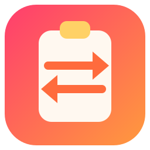

<div align="center">
  
  <h1>ClipboardSync</h1>
  <p><strong>複製一次，貼到你的每一台裝置。</strong></p>
  <p>
    <a href="https://t2penbix99wcoxkv3a4g.github.io/ClipboardSync/">網站</a> ·
    <a href="https://t2penbix99wcoxkv3a4g.github.io/ClipboardSync/#/docs/Getting-Started">文件</a>
  </p>
  <p>
    <a href="README.md">English</a> ·
    <a href="README.ja.md">日本語</a> ·
    <a href="README.zh-CN.md">简体中文</a>
  </p>
</div>

ClipboardSync 讓已配對裝置共用同一塊剪貼簿看板。在一台裝置上複製文字、連結、圖片、檔案或資料夾，
其他裝置就會顯示出來，可以直接貼上。所有裝置都透過加密工作階段直接通訊，不需要帳號，也沒有中間
伺服器。

## 功能

- **共用看板** — 所有已配對裝置顯示同一份歷史記錄，項目依來源裝置分組，也包括本機。新的複製會
  傳送給所有對端；對端儲存項目、套用到自己的剪貼簿，並在其他對端仍缺少該項目時繼續轉發。
- **文字與連結** — 複製文字或 URL 時會傳送到其他裝置，並套用到它們的剪貼簿。
- **圖片** — 複製的圖片會以 PNG 傳送、在看板上預覽，並自動套用到剪貼簿。大小上限可在 1 到
  32 MB 之間設定（預設 10 MB）。
- **檔案與資料夾** — 複製的內容會遞迴走訪，每個檔案存成以 SHA-256 內容定址的 blob。對端只拉取
  缺少的範圍，因此重新連線後會從停下的位置繼續，相同內容只佔一份 blob。收到的項目會用硬連結
  （不支援時複製）還原，並以一般檔案和資料夾放回剪貼簿。
- **直接連線** — 裝置透過 UDP 在區域網路內找到彼此，並透過 TCP 通訊。不經過第三方，無法廣播的
  網路可以手動填寫位址。
- **加密工作階段** — 每台裝置都有長期的 Ed25519 身分金鑰。每次連線使用新的 X25519 臨時金鑰，
  由 HKDF-SHA256 推導工作階段金鑰，每個訊框都用 ChaCha20-Poly1305 加密，並以握手記錄作為關聯
  資料。
- **配對碼** — 兩邊畫面會從握手推導出同一組短碼，讓你在信任裝置前先比對。配對碼不會當成密碼
  傳送。
- **每個項目的傳輸狀態** — 已同步、傳送中、接收中、等待中或失敗，並顯示有多少對端持有該項目。
- **最終一致** — 定期核對會重送尚未被確認的項目；再次配對會把目前看板補發過去；曾經離線的裝置
  在恢復後會自動補齊。

## 使用技術

- **以 .NET 11 為基礎的 C#** — 剪貼簿、網路、加密、歷史、系統匣和設定。
- **React 19 + TypeScript**，由 **Vite** 打包，使用 **styled-components** 撰寫樣式 — 介面。
- **Photino.NET** — 桌面外殼。
- **BouncyCastle** — Ed25519、X25519 和 ChaCha20-Poly1305。
- **SQLite** — 歷史、傳輸狀態和檔案 manifest。

## 執行

已發佈的建置是 **自包含** 的，不需要另外安裝 .NET。作業系統仍需提供以下內容。

同時發佈四種套件格式：

| 檔案                                           | 作用                                                                                                                                        |
|------------------------------------------------|---------------------------------------------------------------------------------------------------------------------------------------------|
| `ClipboardSync-<version>-win-x64.msi`          | 目前使用者的 Windows 安裝程式：安裝到 `%LOCALAPPDATA%\Programs\ClipboardSync`，新增開始功能表和桌面捷徑，不會要求系統管理員權限。           |
| `clipboardsync-<version>-1.fcXX.x86_64.rpm`    | Fedora 套件：`sudo dnf install ./clipboardsync-<version>-*.rpm`。安裝到 `/opt/ClipboardSync`，並提供 `clipboardsync` 命令、桌面項目和圖示。 |
| `clipboardsync_<version>_amd64.deb`            | Debian/Ubuntu 套件：`sudo apt install ./clipboardsync_<version>_amd64.deb`。配置與 RPM 相同。                                               |
| `clipboardsync-<version>-1-x86_64.pkg.tar.zst` | Arch Linux 套件：`sudo pacman -U clipboardsync-<version>-1-x86_64.pkg.tar.zst`。配置與 RPM 相同。                                           |

### Windows

1. Microsoft Edge **WebView2 執行階段**。Windows 10 和 11 通常已經內建；如果沒有，請使用
   [Microsoft 的頁面](https://developer.microsoft.com/microsoft-edge/webview2/)。
2. Windows 10 或更新版本，x64。
3. 建置沒有程式碼簽章，第一次啟動時 Windows 可能會提示警告。

### Linux

1. 用於 GTK 的 Web 檢視。
2. AppIndicator 函式庫，僅用於系統匣圖示。沒有它應用程式仍可執行，只是沒有系統匣，主視窗會
   一直顯示。
3. 自包含建置所需的 .NET 執行階段函式庫（ICU、OpenSSL、zlib、krb5、fontconfig、freetype）會由
   套件帶入。普通壓縮檔則需要手動安裝。

| 發行版          | 套件                                                                         |
|-----------------|------------------------------------------------------------------------------|
| Fedora          | `sudo dnf install webkit2gtk4.1 libayatana-appindicator-gtk3 libnotify`      |
| Debian / Ubuntu | `sudo apt install libwebkit2gtk-4.1-0 libayatana-appindicator3-1 libnotify4` |
| Arch Linux      | `sudo pacman -S webkit2gtk-4.1 libayatana-appindicator`                      |
| 其他            | 尋找提供下列函式庫的套件                                                     |

```
libwebkit2gtk-4.1.so.0          libjavascriptcoregtk-4.1.so.0
libgtk-3.so.0                   libglib-2.0.so.0
libayatana-appindicator3.so.1   （或較舊的 libappindicator3.so.1）
```

缺少 Web 檢視函式庫時，啟動會顯示 `Unable to load shared library 'Photino.Native'`。要找出提供
缺少 soname 的套件，可以詢問套件管理員，例如 `dnf provides 'libwebkit2gtk-4.1.so.0'`、
`apt-file search libwebkit2gtk-4.1.so.0` 或 `pacman -F libwebkit2gtk-4.1.so.0`。

## 首次執行

1. **啟動兩台裝置**，確保它們在同一網路中能互相連線。TCP 45456 用於配對和剪貼簿通訊；UDP
   45457 只用於探索提示。
2. **配對它們**：開啟 **裝置 → 配對裝置**，選擇探索到的裝置或輸入位址，然後比對兩邊畫面顯示的
   配對碼。配對會記錄彼此的公開金鑰，並證明雙方確實擁有該金鑰。
3. **複製內容**。項目會出現在兩邊的看板上，並套用到對方的剪貼簿。

完整指南見 [文件](https://t2penbix99wcoxkv3a4g.github.io/ClipboardSync/#/docs/Getting-Started)。

## 建置

- [.NET 11 SDK](https://dotnet.microsoft.com/download)
- [Node.js](https://nodejs.org/) 20 或更新版本，用於建置介面
- `ClipboardSync/Libs` 中的共用 DLL 和前端橋接套件，透過 `build-and-copy.ps1` 從獨立的
  [PhotinoNETUtils](../PhotinoNETUtils) 專案複製

## 建置與執行

### 開發

介面由 Vite 提供，因此需要同時啟動兩邊：

```bash
# 終端機 1 — 介面位於 http://127.0.0.1:3300
cd ClipboardSync/UserInterface
npm install
npm run dev

# 終端機 2 — 桌面應用程式
dotnet run --project ClipboardSync
```

偵錯建置會從開發伺服器載入介面。`dotnet run --project ClipboardSync -- --identity` 會印出配對
使用的穩定 ID、公開金鑰和指紋。

## 資料儲存位置

|            | Windows                                            | Linux                                              |
|------------|----------------------------------------------------|----------------------------------------------------|
| 設定       | `%APPDATA%\ClipboardSync\settings.json`            | `~/.config/ClipboardSync/settings.json`            |
| 已配對裝置 | `%APPDATA%\ClipboardSync\peers.json`               | `~/.config/ClipboardSync/peers.json`               |
| 裝置身分   | `%APPDATA%\ClipboardSync\device.key`               | `~/.config/ClipboardSync/device.key`               |
| 歷史       | `%LOCALAPPDATA%\ClipboardSync\history.db`          | `~/.local/share/ClipboardSync/history.db`          |
| 圖片快取   | `%LOCALAPPDATA%\ClipboardSync\clipboard`           | `~/.local/share/ClipboardSync/clipboard`           |
| 檔案 blob  | `%LOCALAPPDATA%\ClipboardSync\clipboard\blobs`     | `~/.local/share/ClipboardSync/clipboard/blobs`     |
| 檔案檢視   | `%LOCALAPPDATA%\ClipboardSync\clipboard\items`     | `~/.local/share/ClipboardSync/clipboard/items`     |
| 日誌       | `%APPDATA%\ClipboardSync\logs\clipboardsync-*.log` | `~/.config/ClipboardSync/logs/clipboardsync-*.log` |

身分金鑰就是配對時對方記錄的公鑰，因此設定資料夾應只允許你的帳戶存取。歷史記錄的上限由 **設定 → 歷史 → 保留項目數** 控制。

日誌會寫入檔案，同時鏡像到主控台，因此回報問題時提供日誌檔就夠了。日誌每天輪替，保留最近
7 天。

## 注意

- 檔案與資料夾會遞迴複製；一次選擇受 **設定 → 同步 → 檔案大小上限**（預設 512 MB）和 1,000 個
  項目限制。blob 依內容定址並在項目間共用；還原的檢視會在檔案系統允許時使用硬連結。傳輸是加密
  的，但磁碟上的 blob 儲存仍是本機資料夾中的一般明文檔案。
- **設定 → 同步 → Blob 儲存資料夾** 可以變更 blob 的位置。留空則使用應用程式資料夾；變更後會
  移動現有的 blob。
- **設定 → 歷史 → 清除歷史** 會清除所有已配對裝置的看板。系統剪貼簿不會被變更。
- 裝置網路依賴每台裝置都能透過 TCP 45456 連線其他裝置。UDP 45457 只是探索提示；如果廣播被
  阻擋，請使用手動位址欄。
- 關閉視窗會將應用程式放入系統匣。如果希望啟動時就隱藏，請開啟 **啟動時隱藏視窗**；沒有系統匣
  的環境會始終顯示視窗。
- `PhotinoNETUtils` 以 DLL/NPM tarball 的形式從 `Libs/` 引用。更新該函式庫後請重新執行
  `build-and-copy` 腳本；`ClipboardSync` 已經在目標清單中。

## 授權

MIT — 見 [LICENSE](LICENSE)。
